# 📸 Screenshots

What the setup looks like, without installing it. Everything is in the default
**cocoa** theme unless noted. Back to the [README](README.md).

## Desktop

The bare desktop: wallpaper and the bar.

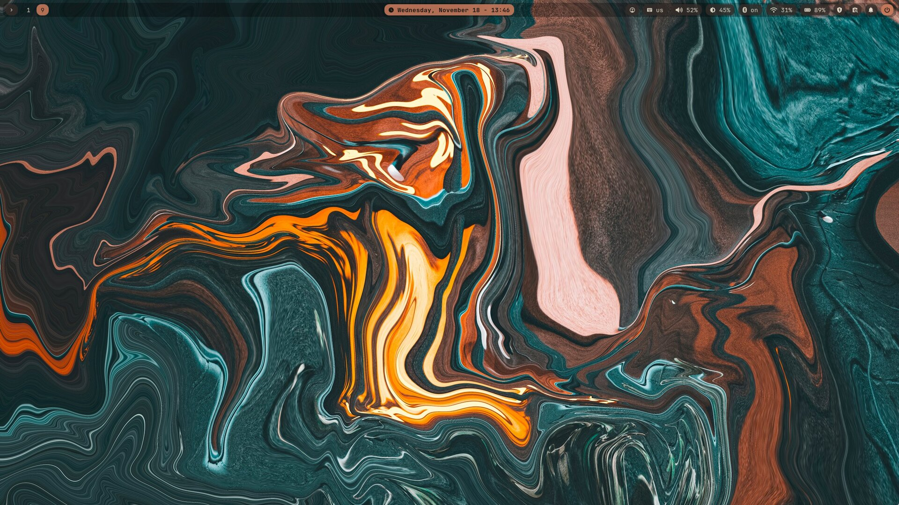

Tiled windows: fastfetch, btop and vim in kitty.

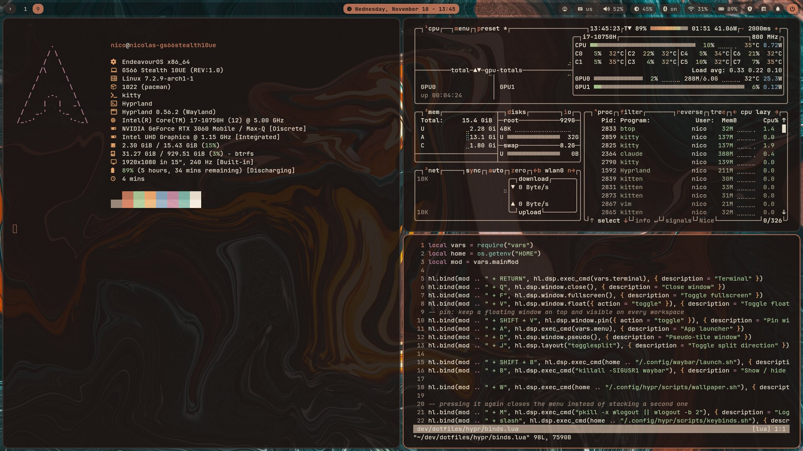

## Themes

`SUPER + T` picks a theme and `SUPER + SHIFT + T` cycles; the bar, terminals, menus,
notifications and lock screen all follow it.

| nord | gruvbox |
| --- | --- |
| 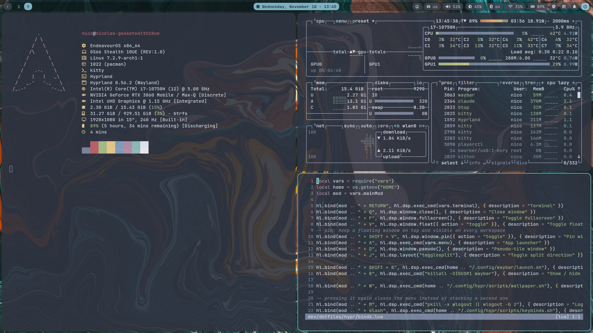 | 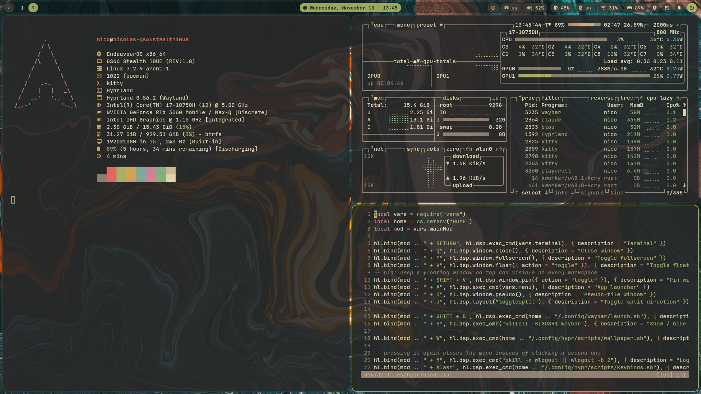 |
| **rose-pine-moon** | **cocoa** (default) |
| 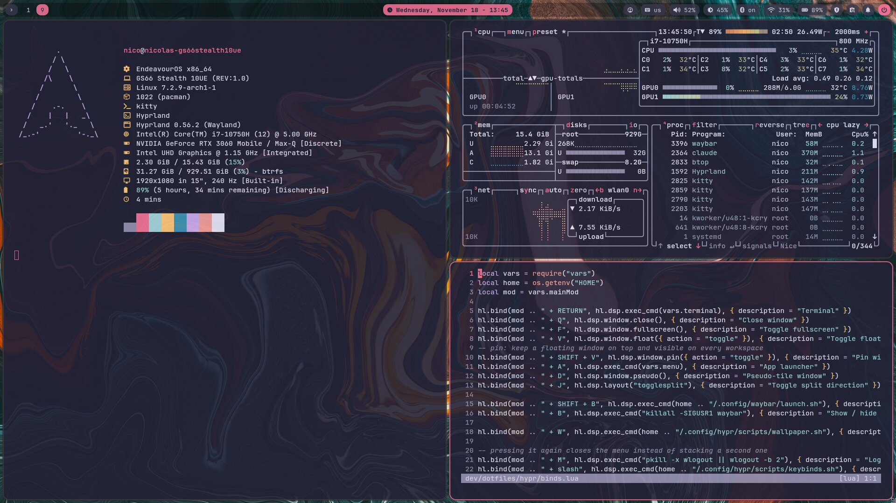 |  |

## The bar

Workspaces, the clock, then the indicators: hardware stats, keyboard layout, volume,
brightness, bluetooth, wifi, battery, and the tlock, OCR, do-not-disturb and power
buttons.

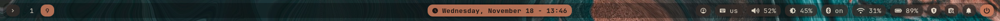

Hover the gauge for CPU, temperature, disk and memory:

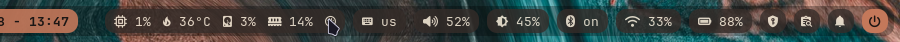

Hover the clock for the calendar (scroll to change month), with today marked:

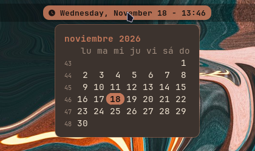

Tooltips, here the battery's time left and its power profile clicks:

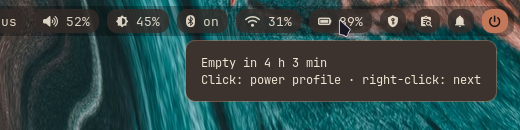

Notifications (mako); urgent ones get a red outline and stay until dismissed:

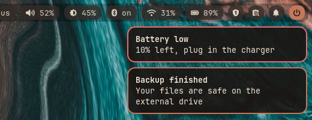

## Menus

App launcher, `SUPER + A`:

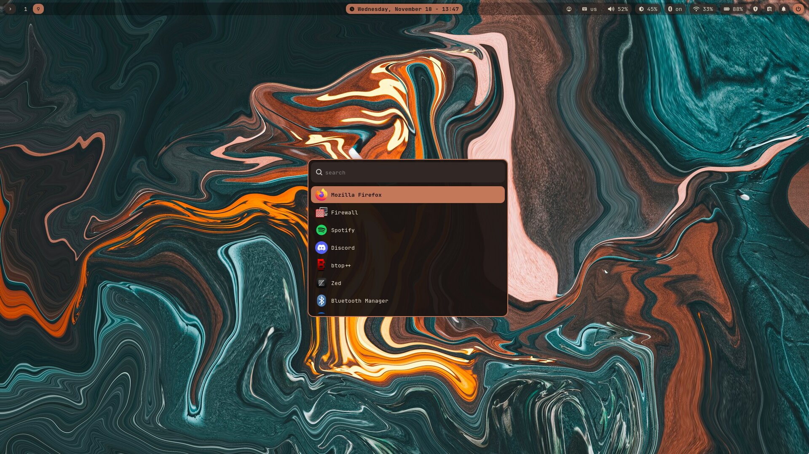

Hotkeys, `SUPER + /`: every shortcut, read live from Hyprland, type to search:

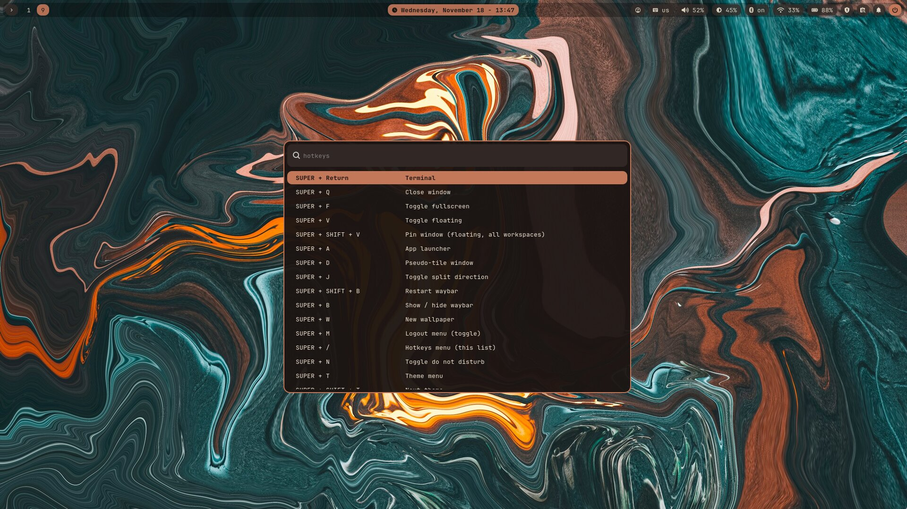

Theme picker, `SUPER + T`:

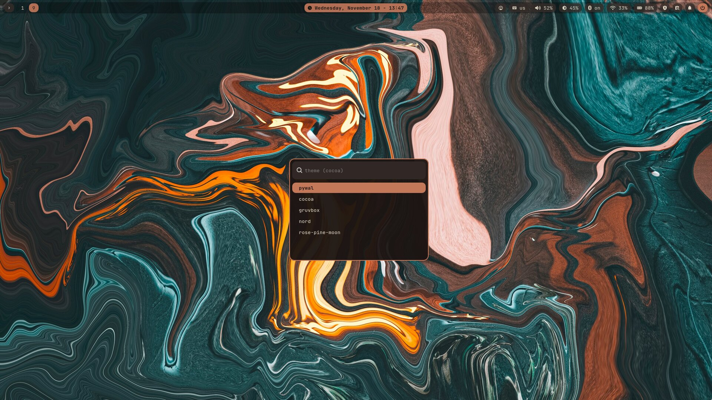

Power profile picker, click the battery:

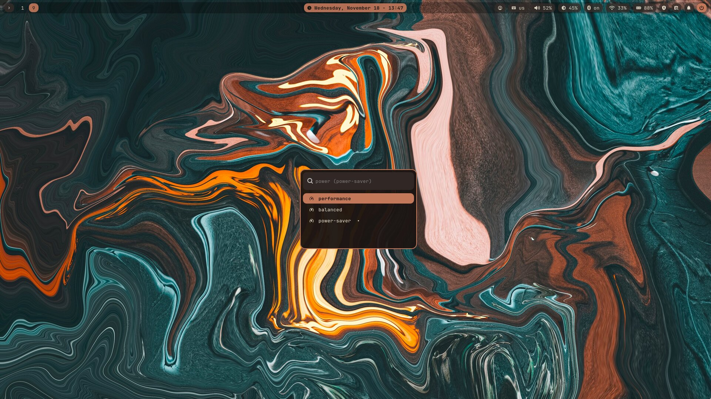

Power menu, `SUPER + M` (arrow keys and Enter work too):

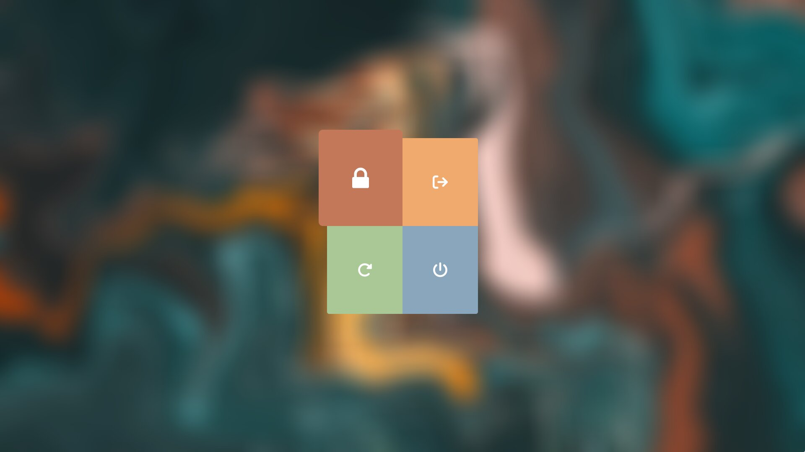

## Lock screen

hyprlock, with the notifications that arrived while it was locked:

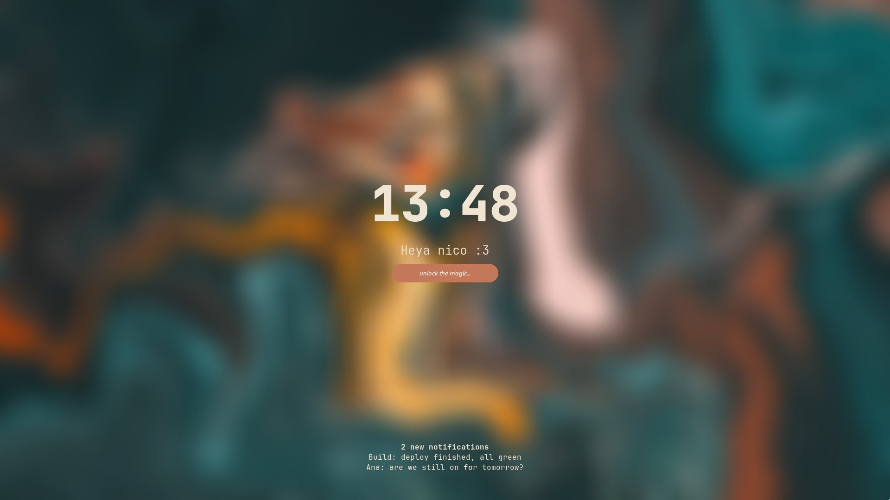
